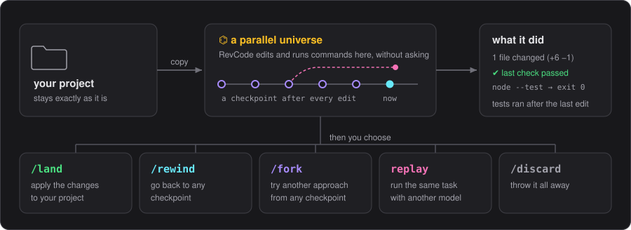
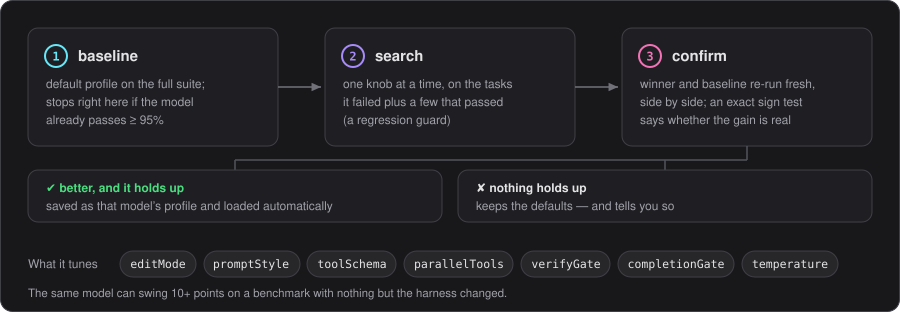

<p align="center">
  <picture>
    <source media="(prefers-color-scheme: dark)" srcset="docs/assets/logo-dark.svg">
    <source media="(prefers-color-scheme: light)" srcset="docs/assets/logo-light.svg">
    
  </picture>
</p>

<p align="center">
  <picture>
    <source media="(prefers-color-scheme: dark)" srcset="docs/assets/tagline-dark.svg">
    <source media="(prefers-color-scheme: light)" srcset="docs/assets/tagline-light.svg">
    
  </picture>
</p>

<p align="center">
  It codes in a parallel copy of your project, so there's nothing to approve and nothing it can wreck.<br>
  Like what it did? <code>/land</code> it. Don't? It never happened.
</p>

<p align="center">
  
  
  <a href="LICENSE"></a>
</p>

<p align="center">
  
</p>

<p align="center"><sub>Real session, real model. RevCode fixes a failing test in its universe, then <code>/land</code> brings the fix home.</sub></p>

## Install

```bash
git clone https://github.com/ayaan-gupta/RevCode && cd RevCode
npm install && npm run bundle
cp dist/revcode.mjs ~/.local/bin/revcode   # it's one file, put it anywhere on your PATH
revcode                                    # first run asks which model to use
```

Node 20+, `git`, `ripgrep` and `bash`. Linux or macOS.

## Parallel universes

<p align="center"></p>

Start `revcode` in a git repo and it forks your project into a universe. Same files, same uncommitted changes, same git history. That's where the agent works.

It edits code, runs your tests, breaks things and fixes them, and you approve none of it. Your real files aren't involved. Anything that leaves the universe still asks first: `git push`, deploys, `sudo`.

Every step is a checkpoint. Went sideways at step 6? `/rewind 5` puts back the files *and* the conversation.

Done? `/land` merges the result into your project. If you edited the same files in the meantime, it merges around your changes. It won't overwrite them.

Keep coding the whole time, by the way. Your edits get pulled into the universe before each answer.

### Isn't that just a git worktree?

No. A worktree is a checkout of your last commit, and that's all it is.

| | git worktree | universe |
| --- | --- | --- |
| Starts from | your last commit | what's on disk right now, uncommitted work and `.env` included |
| Undo | whatever you committed | any step |
| Sees your new edits | no | before every answer |
| Getting changes back | commit, merge, cherry-pick | `/land` |
| Your `.git` | shared (branches, refs) | never written |
| Three tries at once | three worktrees, by hand | `revcode race` |
| Setup | `git worktree add`, reinstall deps | none |

## Race

<p align="center"></p>

Models are inconsistent. Ask the same one twice and you can get two different fixes, one of them wrong. So don't ask once:

```bash
revcode race "fix the flaky checkout test"
```

Three attempts run side by side, each in its own universe. Your test suite grades them, and the winner is one keypress from landing. Mix models with `--models glm-5.2,anthropic:claude-sonnet-5-5`. Cap the bill with `--max-cost 1`.

## Also

- **Ship on green:** `revcode run "bump deps" --land-if "npm test"` lands only if the tests pass. Built for cron and CI
- **Spending cap:** every answer shows what it cost, and `--max-cost 2` won't let a session go past two dollars
- **Fork:** `/fork 4` spins off a second universe from step 4 to try another idea
- **Rematch:** replay a whole session on a different model, then compare the two results
- **Self-tuning:** `revcode tune` works out which prompts and edit formats your model handles best
- **Any model:** GLM, Claude, OpenAI, OpenRouter, Ollama, or anything that speaks the OpenAI API
- **Tiny:** one 1 MB file, zero dependencies. Claude Code weighs about 300 MB
- **Extensible:** `AGENTS.md`, MCP, skills, hooks and your own slash commands

## Self-tuning

<p align="center"></p>

Put the same model in two different harnesses and its score can move by 10 points or more. `revcode tune` runs a suite of coding tasks against your model and tries one setting at a time. The winner has to win again on a fresh run, because lucky streaks happen. After that it loads on its own.

```bash
revcode tune --model glm-5.2 --dry-run      # see the plan, no model calls
revcode tune --model glm-5.2 --budget 150   # run it
```

## Docs

[Universes](docs/universes.md) · [Race](docs/race.md) · [Self-tuning](docs/dyno.md) · [Terminal UI and keys](docs/tui.md) · [Benchmark notes](docs/terminal-bench.md) · [Reference](docs/reference.md)

## License

MIT. Some techniques and code are adapted from open-source projects; see [THIRD_PARTY_NOTICES.md](THIRD_PARTY_NOTICES.md).
