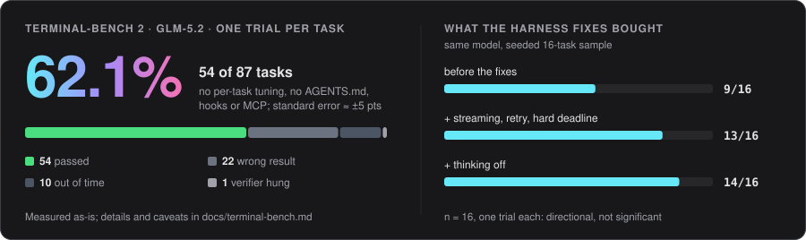

<p align="center">
  <picture>
    <source media="(prefers-color-scheme: dark)" srcset="docs/assets/logo-dark.svg">
    <source media="(prefers-color-scheme: light)" srcset="docs/assets/logo-light.svg">
    
  </picture>
</p>

<h3 align="center">The terminal coding agent that works in a parallel universe.</h3>
<p align="center">Let it run with no prompts. Review one changeset. Land only what you like.</p>

<p align="center">
  <a href="docs/terminal-bench.md"></a>
  
  <a href="LICENSE"></a>
</p>

<p align="center">
  <a href="#install">Install</a> ·
  <a href="#parallel-universes">Parallel Universes</a> ·
  <a href="#dyno">Dyno</a> ·
  <a href="#the-terminal-ui">Terminal UI</a> ·
  <a href="#benchmarks">Benchmarks</a> ·
  <a href="#docs">Docs</a>
</p>

<p align="center">
  
</p>

<p align="center"><sub>A real session with GLM-5.2, condensed to its key moments.</sub></p>

## Install

```bash
git clone https://github.com/ayaan-gupta/RevCode && cd RevCode
npm install && npm run build && npm link     # puts `revcode` on your PATH
revcode                                      # first run: pick a provider, paste a key
```

Needs Node 20+, `git`, `ripgrep` and `bash` (Linux and macOS). Keys are saved to `~/.revcode/.env` (mode 0600), never into a project.

```bash
revcode --universe                    # work inside a Parallel Universe
revcode run "fix the failing tests"   # one headless task
revcode --provider anthropic --model claude-sonnet-5-5
```

## Why RevCode

| | |
| --- | --- |
| **Parallel Universes** | Every task runs in an isolated, checkpointed copy of your project. No permission prompts, one changeset to review. |
| **Dyno** | `revcode tune` benchmarks edit formats, prompts and tool schemas on *your* model, and keeps only what holds up. |
| **Receipts** | Every turn ends with what actually ran, what changed, and whether anything checked it afterwards. |
| **Any model** | Z.ai GLM · Claude · OpenAI · OpenRouter · Ollama · any OpenAI-compatible server. |
| **A real terminal UI** | Inline and scrollback-friendly. Type ahead while it works, Esc to interrupt, diffs before you approve, Vim mode. |
| **Extensible** | `AGENTS.md`, MCP, skills, hooks, subagents, custom slash commands. |

## Parallel Universes

<p align="center"></p>

Permission prompts wear you down, and unrestricted mode is a gamble. A universe changes the question: let the agent do anything *to a copy*, then review the result once.

```bash
revcode --universe                                            # or "universe": true in config
revcode universes land <id>                                   # 3-way merge into your project
revcode universes replay <id> --model claude-sonnet-5-5       # same prompts, another model
revcode universes compare <a> <b> --verify "pytest -q"        # side by side, with a real pass/fail
```

Landing never overwrites a conflicting change you made yourself. Guarantees and limits: [docs/universes.md](docs/universes.md).

## Dyno

<p align="center"></p>

The same model can move 10+ points on a benchmark with nothing changed but the harness. Dyno searches those choices per model and **confirms the winner against a fresh baseline**, so a lucky re-run cannot pass for a gain. If nothing helps, it says so and keeps the defaults.

```bash
revcode tune --model glm-5.2 --dry-run      # see the plan, spend nothing
revcode tune --model glm-5.2 --budget 150   # run it; the profile loads automatically from then on
```

Details: [docs/dyno.md](docs/dyno.md).

## The terminal UI

Your conversation stays in the terminal's own scrollback, so select, search and copy work as usual, while a small live block stays pinned at the bottom: activity, prompt, completions, status.

- **Never blocks you.** Type ahead and messages queue. **Esc** interrupts. Permission prompts appear in the same place, with the diff *before* you approve.
- **Real editing.** Multi-line prompts, undo, kill ring, history with **Ctrl+R** search, `@` file completion, pasted blocks that collapse to a placeholder.
- **Readable output.** Markdown with tables and highlighted code, tool calls as compact cards, file diffs with line numbers.
- **Works everywhere.** Truecolor down to `NO_COLOR`, light and dark themes, resize and suspend handled, plain mode for pipes.

Keys, terminal notes and internals: [docs/tui.md](docs/tui.md).

## Benchmarks

<p align="center"></p>

One trial per task with no per-task tuning, so read it as roughly 60%, not a leaderboard-grade number. Failures, noise and what is not yet known: [docs/terminal-bench.md](docs/terminal-bench.md).

## Docs

[Parallel Universes](docs/universes.md) · [Dyno](docs/dyno.md) · [Terminal UI](docs/tui.md) · [Terminal-Bench notes](docs/terminal-bench.md) · [Reference: tools, permissions, extending, layout](docs/reference.md) · [Memory design](docs/memory-design.md)

## License

MIT. Some techniques and code are adapted from open-source harnesses; see [THIRD_PARTY_NOTICES.md](THIRD_PARTY_NOTICES.md).
